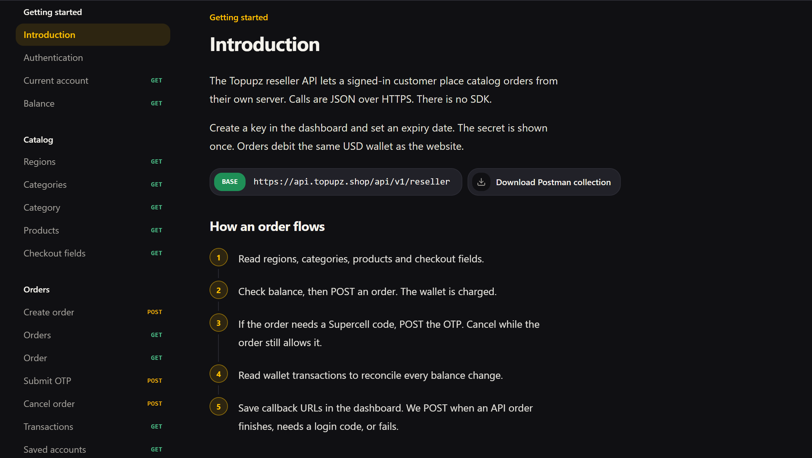
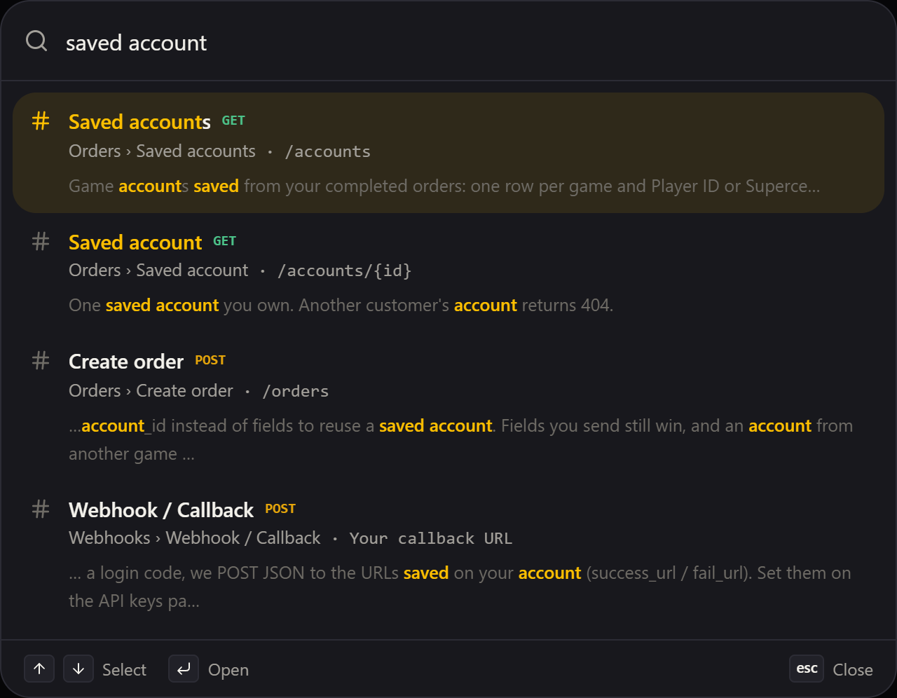
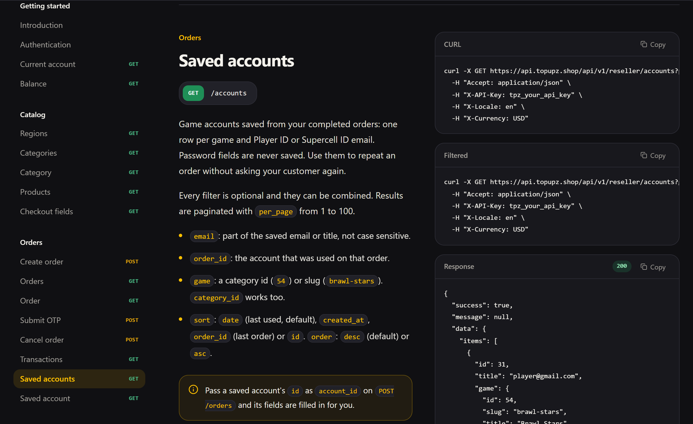
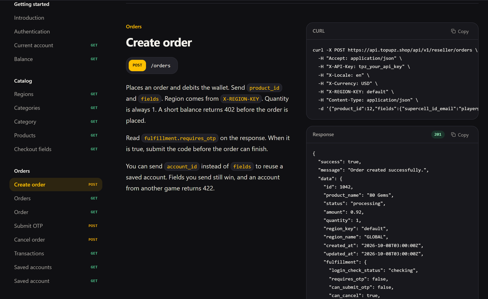
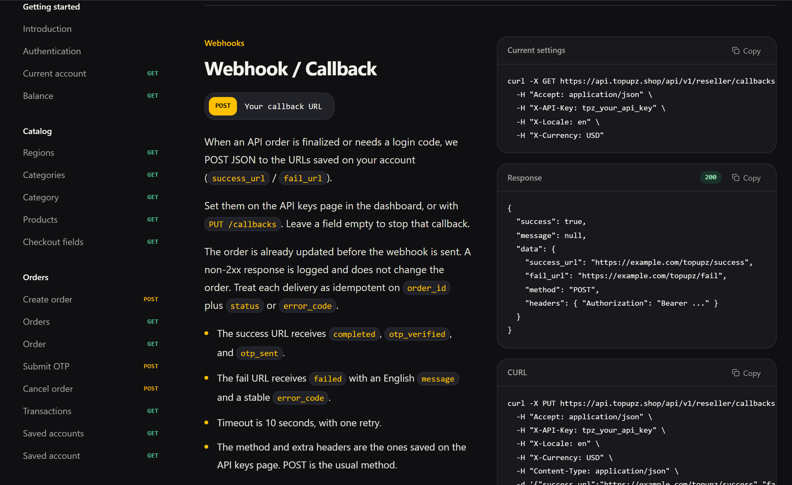

<h1 align="center">⚡ SupercellTopupAPI ⚡</h1>

<p align="center">
  💎 <b>API for Supercell top-ups (<a href="https://topupz.shop">topupz.shop</a>)</b>: Brawl Stars gems, Clash of Clans gems, Clash Royale gems, Hay Day diamonds and passes, delivered automatically to the player's Supercell ID. 💎
</p>

<p align="center">
  <a href="https://topupz.shop/en/docs"></a>
  
  
</p>

<p align="center">
  
</p>

---

## 📖 Contents

- [What you can do](#-what-you-can-do)
- [Supported games](#-supported-games)
- [Quick start](#-quick-start)
- [Brawl Stars Gems API](#-brawl-stars-gems-api)
- [Clash of Clans Gems API](#-clash-of-clans-gems-api)
- [Clash Royale & Hay Day API](#-clash-royale--hay-day-api)
- [Endpoints](#-endpoints)
- [Saved accounts](#-saved-accounts)
- [Order flow and OTP](#-order-flow-and-otp)
- [Webhooks / callbacks](#-webhooks--callbacks)
- [Errors](#-errors)
- [Examples](#-examples)

## ✨ What you can do

- 🛒 Read the live catalog: games, regions, products and prices
- 💳 Place top-up orders paid from your Topupz USD wallet
- 🔐 Submit the Supercell login code (OTP) when an order needs it
- 📡 Get webhooks when an order completes, needs a code, or fails
- 💾 Reuse saved game accounts: filter by email, order or game, sort by date or order id
- 📊 Reconcile every balance change through wallet transactions
- 🌍 Prices in your currency (`X-Currency`) and names in your language (`X-Locale`)

## 🎮 Supported games

| Game | Category ID | What you can top up |
|---|---|---|
| **Brawl Stars** | `54` | 30 – 2 000 Gems, Brawl Pass, Brawl Pass Plus, Pass → Pass Plus upgrade, Pro Pass |
| **Clash of Clans** | `55` | 80 – 14 000 Gems, Gold Pass |
| **Clash Royale** | `56` | 80 – 14 000 Gems, Diamond Pass |
| **Hay Day** | `57` | 50 – 4 000 Diamonds, Farm Pass, All Pass Bundle |

The live list is always what `GET /categories` returns.

## 🚀 Quick start

1. Sign up at **[topupz.shop](https://topupz.shop)** and top up your wallet.
2. Open **Dashboard → API keys** and create a key. The secret is shown once.
3. Send it in the `X-API-Key` header (or `Authorization: Bearer <key>`).

**Base URL**

```
https://api.topupz.shop/api/v1/reseller
```

```bash
curl https://api.topupz.shop/api/v1/reseller/balance \
  -H "Accept: application/json" \
  -H "X-API-Key: tpz_your_api_key"
```

```json
{ "success": true, "message": null, "data": { "balance": 48.5, "currency": "USD" } }
```

| Header | Required | Meaning |
|---|---|---|
| `X-API-Key` | ✅ | Your secret key |
| `X-Locale` | — | Language for product names and messages (`en`, `ru`, `tr`, `az` …) |
| `X-Currency` | — | Display currency (`USD`, `RUB`, `TRY` …). The wallet is always charged in USD |
| `X-REGION-KEY` | — | Region for prices and orders (`default`, `tr` …), from `GET /regions` |

## 💎 Brawl Stars Gems API

Find the Brawl Stars category, pick a gem pack, and order it for a Supercell ID email:

```bash
# 1. Brawl Stars products
curl "https://api.topupz.shop/api/v1/reseller/products?category_id=54" \
  -H "X-API-Key: tpz_your_api_key"

# 2. Buy 80 gems
curl -X POST https://api.topupz.shop/api/v1/reseller/orders \
  -H "X-API-Key: tpz_your_api_key" \
  -H "X-REGION-KEY: default" \
  -H "Content-Type: application/json" \
  -d '{"product_id":12,"fields":{"supercell_id_email":"player@gmail.com"}}'
```

## 🏰 Clash of Clans Gems API

It works the same way: use the Clash of Clans category (`55`), then `POST /orders` with the product ID and the fields from `GET /categories/{id}/checkout-fields`.

## 👑 Clash Royale & Hay Day API

Clash Royale gems and Diamond Pass (category `56`), Hay Day diamonds and Farm Pass (category `57`) use the same flow. Every game is one category, and its checkout fields tell you what to send.

## 📚 Endpoints

| Method | Path | Description |
|---|---|---|
| `GET` | `/me` | Account behind the key and live wallet balance |
| `GET` | `/balance` | Wallet balance in USD |
| `GET` | `/regions` | Regions you can buy in |
| `GET` | `/categories` | Games (Brawl Stars, Clash of Clans …) with their checkout fields |
| `GET` | `/categories/{id}` | One game |
| `GET` | `/categories/{id}/products` | Products of one game, paginated |
| `GET` | `/categories/{id}/checkout-fields` | Fields an order needs (e.g. `supercell_id_email`) |
| `GET` | `/products` | Products, filter with `?category_id=` |
| `GET` | `/products/{slug}` | One product with regional price |
| `POST` | `/orders` | Place an order, paid from the wallet (send `fields` or a saved `account_id`) |
| `GET` | `/orders` | Your orders, paginated |
| `GET` | `/orders/{id}` | One order with fulfillment status |
| `POST` | `/orders/{id}/otp` | Submit the Supercell login code |
| `POST` | `/orders/{id}/cancel` | Cancel while the order allows it |
| `GET` | `/accounts` | Saved game accounts, with filters and sorting |
| `GET` | `/accounts/{id}` | One saved account |
| `GET` | `/transactions` | Wallet transactions |
| `GET` | `/transactions/{id}` | One transaction |
| `GET` / `PUT` | `/callbacks` | Read or save webhook URLs |
| `GET` | `/callbacks/log` | Every callback sent to you (catch up on missed ones) |

Full reference with every response: **[topupz.shop/docs](https://topupz.shop/en/docs)** · Postman collection on the same page. Press <kbd>Ctrl</kbd> <kbd>K</kbd> there to search the docs.

<p align="center"></p>

## 💾 Saved accounts

<p align="center"></p>

Every completed order saves the game account it used (Player ID / Supercell ID email, never passwords), once per game. List them to repeat an order without asking your customer again.

```bash
curl "https://api.topupz.shop/api/v1/reseller/accounts?game=brawl-stars&email=player&sort=order_id&order=asc"   -H "X-API-Key: tpz_your_api_key"
```

| Query | Meaning |
|---|---|
| `email` | Part of the saved email or title, not case sensitive |
| `order_id` | The account used on that order |
| `game` | Category id (`54`) or slug (`brawl-stars`). `category_id` works too |
| `sort` | `date` (last used, default), `created_at`, `order_id` (last order), `id` |
| `order` | `desc` (default) or `asc` |
| `per_page` | 1 – 100 (default 20) |

```json
{
  "success": true,
  "message": null,
  "data": {
    "items": [
      {
        "id": 31,
        "title": "player@gmail.com",
        "game": { "id": 54, "slug": "brawl-stars", "title": "Brawl Stars", "image": "https://..." },
        "fields": [{ "name": "supercell_id_email", "label": "Supercell ID email", "value": "player@gmail.com" }],
        "orders": 4,
        "last_order_id": 1042,
        "last_used_at": "2026-11-20T14:05:00+00:00",
        "created_at": "2026-10-08T03:00:00+00:00"
      }
    ],
    "meta": { "current_page": 1, "last_page": 1, "per_page": 20, "total": 1 }
  }
}
```

Order again with a saved account. Its fields are filled in for you (fields you send still win, and an account from another game returns `422`):

```bash
curl -X POST https://api.topupz.shop/api/v1/reseller/orders   -H "X-API-Key: tpz_your_api_key"   -H "Content-Type: application/json"   -d '{"product_id":12,"account_id":31}'
```

## 🔁 Order flow and OTP

<p align="center"></p>

1. `POST /orders` → the wallet is charged and you get the order back (`201`).
2. Read `fulfillment.requires_otp`. When it becomes `true`, Supercell has emailed a login code to the player.
3. `POST /orders/{id}/otp` with `{"otp":"123456"}`.
4. The order goes to `completed`, and a webhook tells you.

```json
{
  "success": true,
  "message": "Order created successfully.",
  "data": {
    "id": 1042,
    "product_name": "80 Gems",
    "status": "processing",
    "amount": 0.92,
    "region_key": "default",
    "fulfillment": {
      "login_check_status": "checking",
      "requires_otp": false,
      "can_submit_otp": false,
      "can_cancel": true,
      "display_status": "processing"
    }
  }
}
```

## 📡 Webhooks / callbacks

<p align="center"></p>

Save a `success_url` and a `fail_url` (dashboard or `PUT /callbacks`). We POST JSON when an order finishes, needs a code, or fails:

```json
{ "order_id": 1042, "status": "otp_sent", "requires_otp": true,
  "message": "OTP has been sent to the Supercell account email. Submit it via the OTP endpoint." }
```

```json
{ "order_id": 1042, "status": "completed", "message": "Order completed successfully." }
```

```json
{ "order_id": 1042, "status": "failed", "error_code": "wrong_otp",
  "message": "Wrong login code. Please check the email and try again." }
```

Treat each delivery as idempotent on `order_id` + `status` / `error_code`. Missed one? Read `GET /callbacks/log`.

## ⚠️ Errors

Every response has `success`, `message`, `data`, and on errors `errors` and sometimes `error_code`.

| Status | Meaning |
|---|---|
| `401` | Invalid, expired or revoked API key |
| `402` | `insufficient_balance`: top up the wallet |
| `404` | Not found |
| `409` | Order still being prepared, try again shortly |
| `422` | Validation error, or the order cannot be cancelled now |

## 🧩 Examples

Ready-to-run clients in [`examples/`](examples):

- [`examples/php/topup.php`](examples/php/topup.php)
- [`examples/node/topup.mjs`](examples/node/topup.mjs)
- [`examples/python/topup.py`](examples/python/topup.py)

## 💬 Support

- Website: [topupz.shop](https://topupz.shop)
- API docs: [topupz.shop/docs](https://topupz.shop/en/docs)

---

<sub>Topupz is an independent top-up service. It is not affiliated with, endorsed or sponsored by Supercell. Brawl Stars, Clash of Clans, Clash Royale and Hay Day are trademarks of Supercell Oy.</sub>
